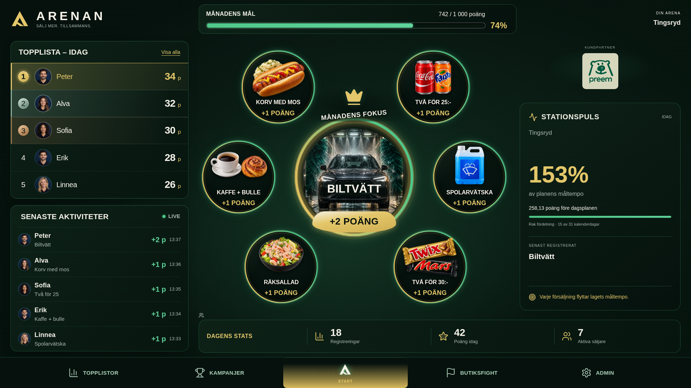
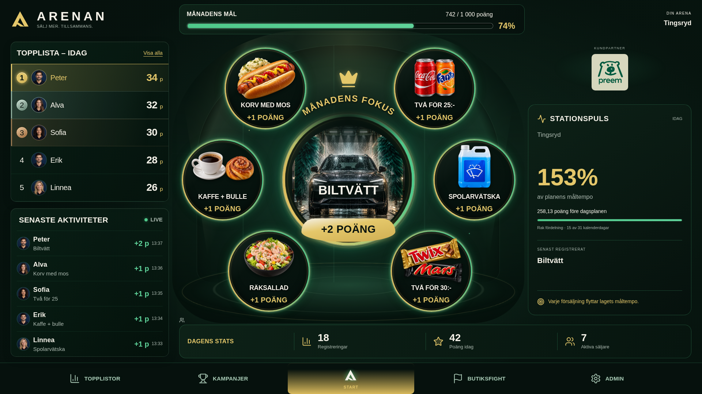
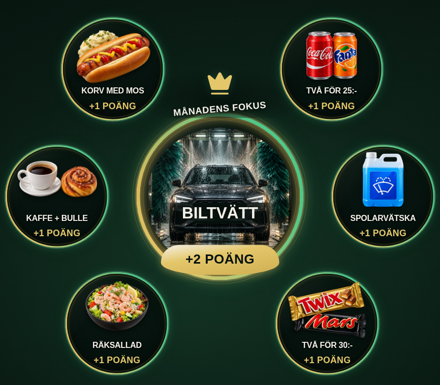
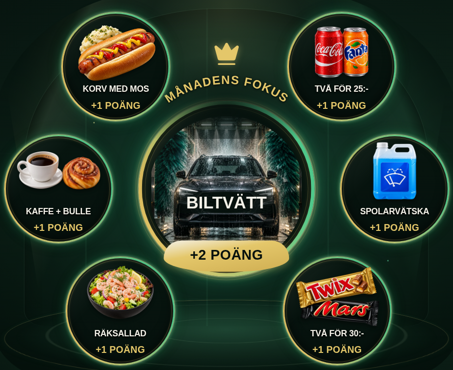
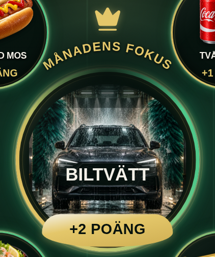
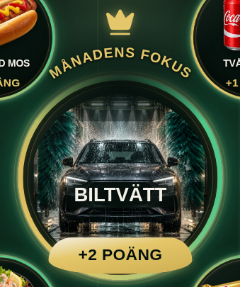
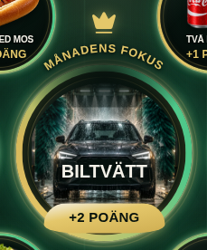
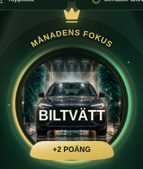
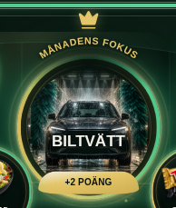

# Visual comparison – strict correction mot grön master

Den låsta gröna visuella mastern som bifogats i chatten är designauktoritet. Följande jämför verklig implementation vid START_HEAD med detta pass. Ingen ny mockup eller omritad referens används som bevis.

## Komposition, ringstorlek, glow och stage

| Viewport | Vänsterspalt före → efter | Satellitdiameter före → efter |
|---|---|---|
| 1920x1080 | 495.0 → 433.0 px (-12.5 %) | 202.7 → 222.1 px (+9.6 %) |
| 1536x864 | 399.4 → 349.4 px (-12.5 %) | 162.5 → 178.1 px (+9.6 %) |
| 1448x1086 | 362.0 → 318.5 px (-12.0 %) | 170.2 → 183.4 px (+7.8 %) |
| 1024x768 | 256.0 → 225.3 px (-12.0 %) | 116.5 → 125.8 px (+8.0 %) |

Närbilder av just den ändrade arenaytan:

| Före | Efter |
|---|---|
|  |  |

- **Vänster:** ungefär 12 % smalare, samma fem personer och fem aktiviteter, läsbar text och portraits. Transparentare material och lättare separators.
- **Ringar:** FHD-diametern 202,7→222,1 px (+9,6 %), samma sju positioner. 4:3 växer cirka 8 %. Mobilens cirkeldimensioner bevaras.
- **Glow:** skarp materialkant, champagne-/grön energy edge, medium glow och bred men svag halo. Fokus starkast. Hover/touch och långsam fokus-aura finns kvar; reduced motion statisk.
- **Stage:** fyra statiska CSS-element för arkitektur, scenljus, elliptiskt reflekterande golv och små atmosfärspunkter. Ett separat begränsat cachelager. Ingen video, bildbakgrund, WebGL, canvas eller filter över hela viewporten.

## MÅNADENS FOKUS – jämförelse med grön master

| Masterns krav | Nuvarande implementation |
|---|---|
| Böjd text längs övre cirkelradien | SVG `M 28 137 A 180 180 0 0 1 332 137`, en riktig cirkelbåge |
| Symmetrisk centrering | `startOffset=50%`, `textAnchor=middle`; ingen rotate eller separat bokstavsrotation |
| Integrerat kron-/focus-element | Centrerad crown i samma insignia, guldfärgad bågtext med kontrollerad spacing |
| Luft till produkten | Bågen ligger utanför övre produktkant; BILTVÄTT läses inne i bilden och primär reward under |
| Responsive och tillgänglig | Samma SVG i alla format, responsiv viewBox, title + aria-labelledby, dekorativ crown aria-hidden |

**Tekniskt verifierad riktig båge**, inte gammal rak text med transform. Detta är ingen automatisk designacceptance. Mänsklig review ska bedöma radie, kronans balans, glownivå och visuell närhet till mastern. Produkter/karaktärer är fortfarande befintliga Arena-assets; ingen tung referens-art har bakats in i knapparna.

Galleriet visar inga duplicerade animationstidsstämplar eller orelaterade före/efter-par. Produktion/showroom separeras; en syntetisk uppladdad testbild demonstrerar uploaded-prioritet och utger sig inte för att vara en verklig anställd.
